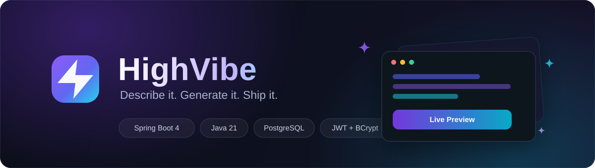
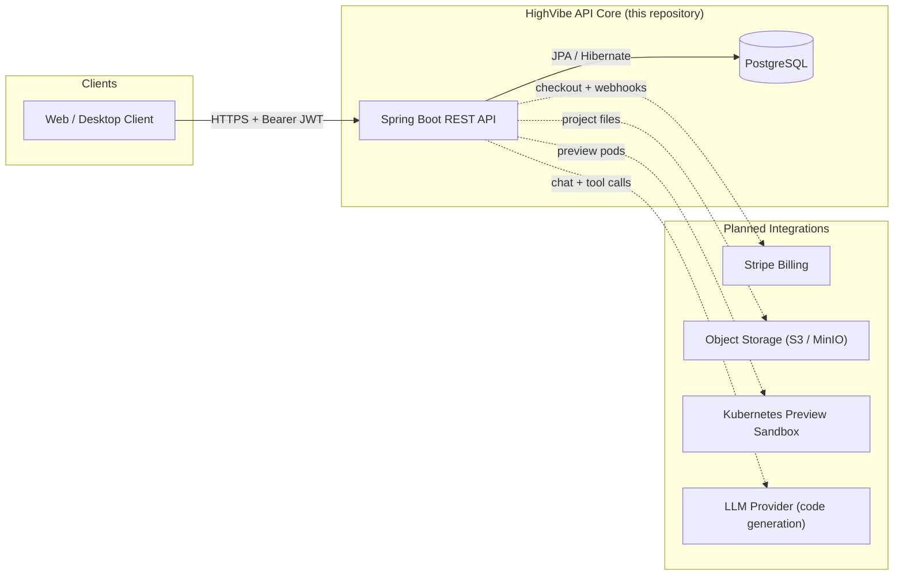
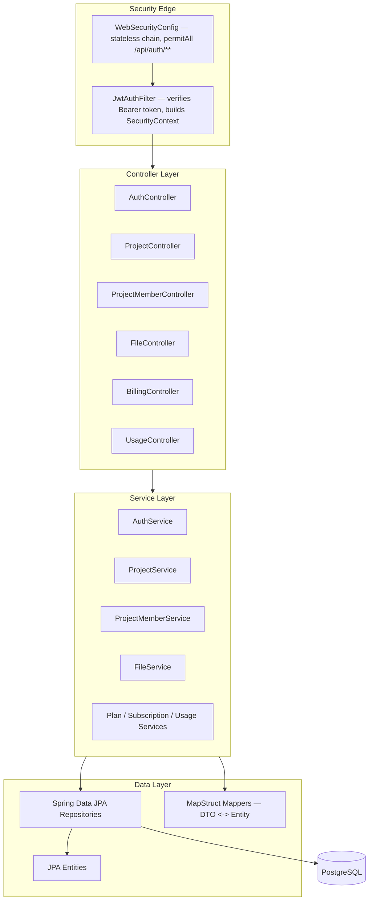
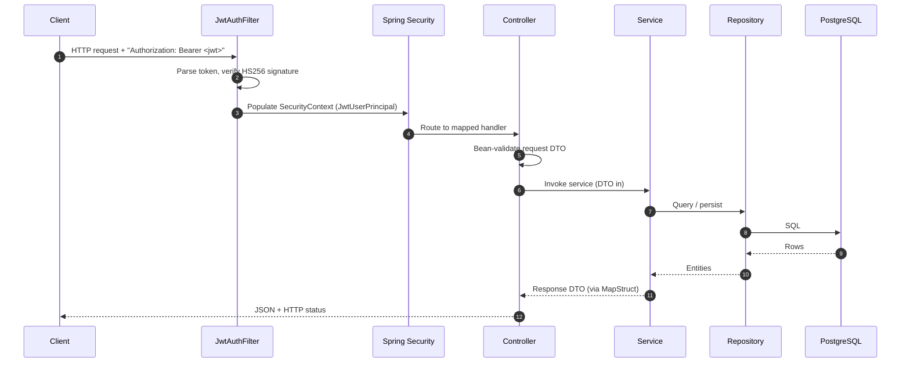
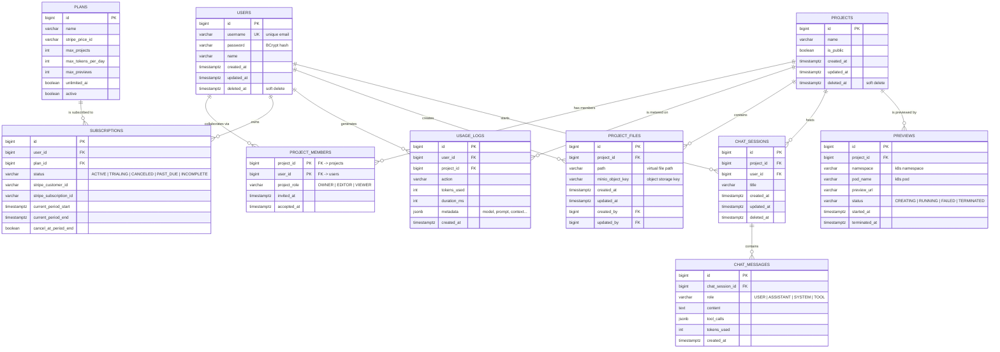
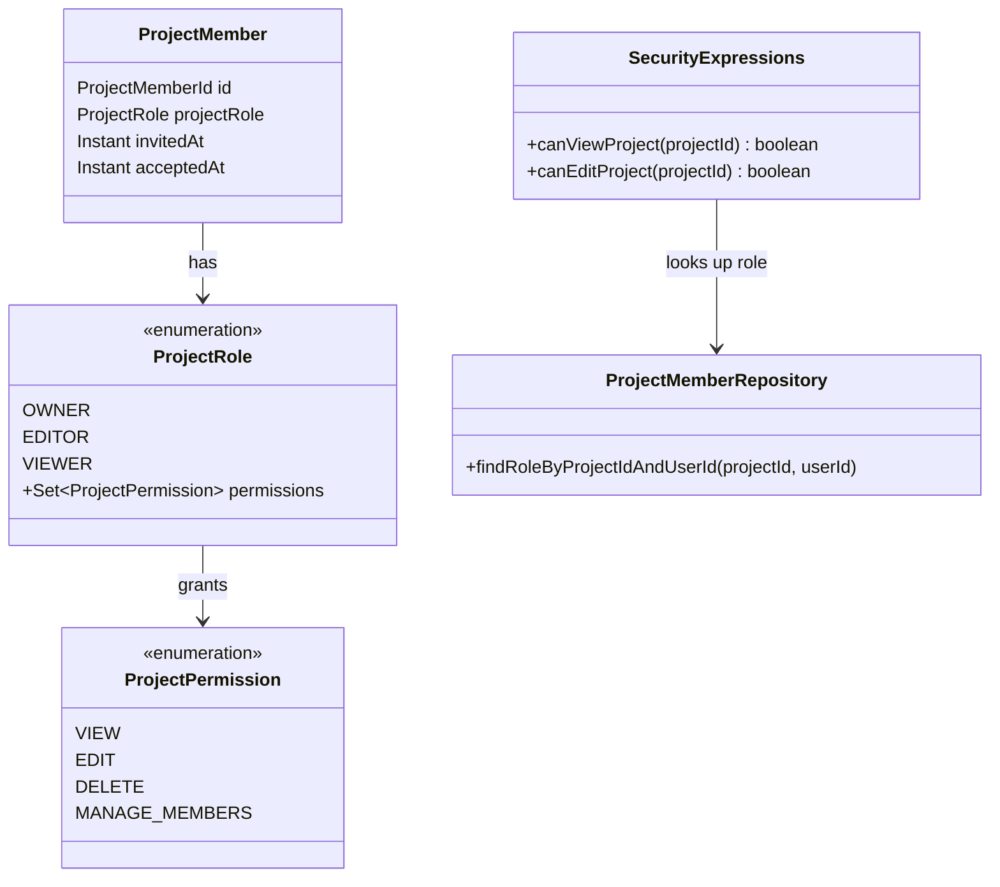
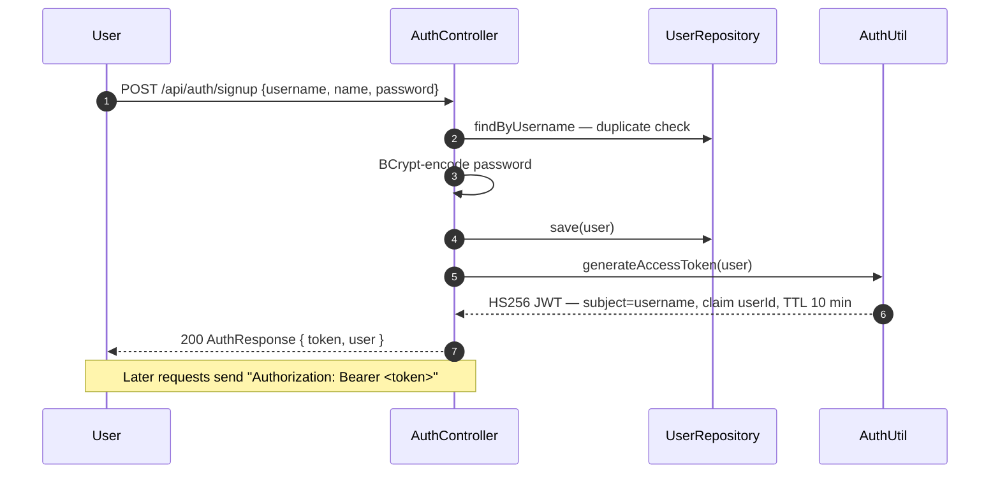
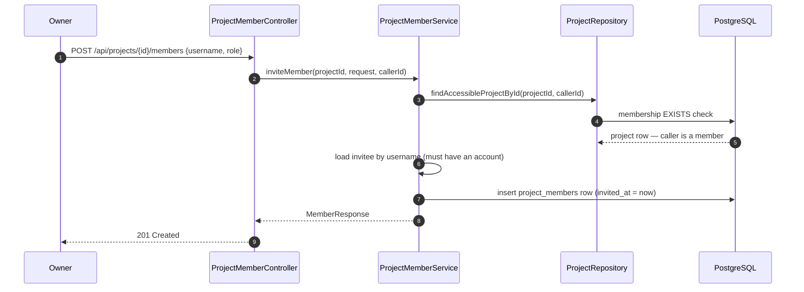
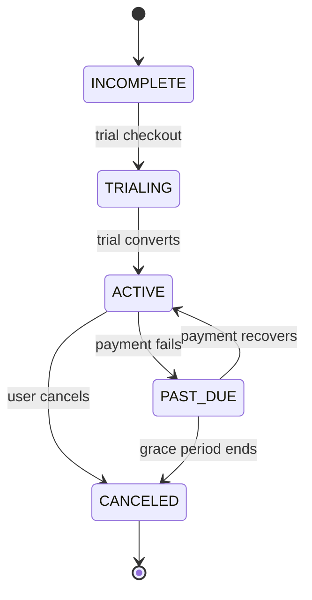
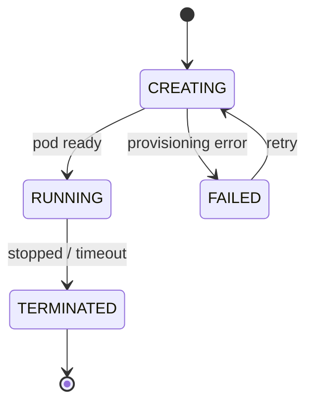

<div align="center">



**A site that creates another site.**

HighVibe is a backend platform for an AI-powered app builder: users describe the app they want,
and the platform generates, previews, and hosts it — with team collaboration, subscriptions, and
usage metering built in. This repository contains the **Spring Boot API core**.

<br/>

[](https://openjdk.org/projects/jdk/21/)
[](https://spring.io/projects/spring-boot)
[](https://www.postgresql.org/)
[](https://maven.apache.org/)
[](https://jwt.io/)

[](https://mapstruct.org/)
[](LICENSE)
[](#feature-status)
[](#contributing)

</div>

---

## Table of Contents

- [About HighVibe](#about-highvibe)
- [Feature Status](#feature-status)
- [Tech Stack](#tech-stack)
- [Architecture (HLD)](#architecture-hld)
- [Low-Level Design (LLD)](#low-level-design-lld)
- [API Reference](#api-reference)
- [Getting Started](#getting-started)
- [30-Day Build Log](#30-day-build-log)
- [Roadmap](#roadmap)
- [Contributing](#contributing)
- [License](#license)
- [Author](#author)

---

## About HighVibe

HighVibe is the backend behind an **AI app-generation platform** — think "a site that creates
another site". Here is the product loop the platform is built around:

1. **Describe** — a user starts a project and chats with the AI about the app they want.
2. **Generate** — the AI pipeline turns prompts into a real, editable file tree (React + backend files).
3. **Preview** — each project gets an isolated, hosted live preview (Kubernetes-sandboxed).
4. **Collaborate** — owners invite teammates as editors or viewers with role-based permissions.
5. **Ship & bill** — plans, subscriptions, and daily token/preview limits gate what users can generate.

This repository implements the **API core** that powers that loop: authentication, project
workspaces and file trees, team collaboration, the domain model for generation/preview/billing,
and the security and error contracts that tie it together.

> **Project status:** actively in development. Authentication, projects, and team collaboration
> are fully implemented and compiling. File access, billing, and usage services are scaffolded
> (contracts + models in place, implementations stubbed) — see [Feature Status](#feature-status).

---

## Feature Status

| Domain | Capability | Status |
| --- | --- | --- |
| Authentication | Email + password signup and login, BCrypt hashing | Implemented |
| Authentication | JWT issuance (HS256, 10-minute TTL) with `userId` claim | Implemented |
| Authentication | Bearer-token filter + stateless security chain | Implemented |
| Authorization | `OWNER` / `EDITOR` / `VIEWER` roles with permission sets | Implemented |
| Authorization | Method security via `@PreAuthorize` + `@security.*` expressions | Implemented |
| Projects | Create / list / get / update, owner bootstrap, soft delete | Implemented |
| Projects | Accessible-project queries (`EXISTS` membership checks) | Implemented |
| Collaboration | Invite, list, re-role, and remove project members | Implemented |
| Collaboration | Guards: no duplicate invites, no self-invites | Implemented |
| Errors | Global exception handling + field-level validation errors | Implemented |
| Project files | File-tree and file-content endpoints backed by object storage | Scaffolded |
| Billing | Plan catalog, Stripe checkout session + customer portal | Scaffolded |
| Usage | Daily usage stats and plan-limit evaluation | Scaffolded |
| AI chat | Chat sessions/messages, tool-calling generation pipeline | Planned |
| Previews | Kubernetes-sandboxed live preview orchestration | Planned |
| Tests | Context boot test + MockMvc auth/endpoint wiring suite | Implemented |
| Tests | Service-layer and Testcontainers integration suites | Planned |

**Legend:** `Implemented` = working end-to-end · `Scaffolded` = interfaces, DTOs, and models
ready — endpoints answer `200` with empty or `null` payloads while the logic is stubbed ·
`Planned` = designed and drafted, not yet implemented — see [Roadmap](#roadmap).

---

## Tech Stack

| Layer | Technology | Notes |
| --- | --- | --- |
| Language | Java 21 | Records, pattern matching, modern switch |
| Framework | Spring Boot 4.1.1 | Web MVC, Validation, Security, Data JPA |
| Database | PostgreSQL | `ddl-auto: update` in dev, Hibernate auto-DDL |
| Migrations | Hibernate (dev) | Flyway/Liquibase on the roadmap |
| Security | Spring Security + JJWT 0.13 | Stateless JWT auth, BCrypt password hashing |
| Mapping | MapStruct 1.6.3 | Compile-time DTO/entity mapping (no reflection) |
| Boilerplate | Lombok | Builders, accessors, constructors |
| Build | Maven (wrapper included) | `mvnw` / `mvnw.cmd` |
| Validation | Jakarta Bean Validation | Declarative request validation on records |

---

## Architecture (HLD)

### System Context

HighVibe is a multi-tenant REST API — the isolation unit is project membership, and every data
query is scoped to the caller's projects. Requests resolve the acting user from the JWT via
`AuthUtil.getCurrentUserId()`. High-level design (HLD): today the API talks only to
PostgreSQL; the surrounding integrations are the planned generation/preview/billing pipeline.



### Layered Design

The codebase follows a strict, testable layered architecture — controllers never touch
repositories, and JPA entities never leak past the service boundary.



**Design principles applied:**

- **DTO boundary** — controllers expose records only; entities stay in the persistence layer.
- **Constructor injection everywhere** — `@RequiredArgsConstructor` + final fields; no field injection.
- **Fail-fast validation** — Jakarta validation on request records, mapped 1:1 by MapStruct.
- **Defense in depth** — URL-level rules in `WebSecurityConfig`, method-level rules via
  `@PreAuthorize`, and query-level scoping (`findAccessibleProjectById`) that filters by caller.
- **Soft deletes** — destructive operations set `deletedAt`; every read query filters it out.

### Request Lifecycle

Every authenticated request passes through the same pipeline:



---

## Low-Level Design (LLD)

Low-level design (LLD) covers the package layout, the data model, and the enforcement
mechanisms:

### Package Structure

```
com.springproject.lovable_clone
├── controller      # REST endpoints — request/response handling only
├── service         # Business contracts (interfaces)
│   └── impl        # Service implementations (transactional logic)
├── repository      # Spring Data JPA repositories + JPQL queries
├── entity          # JPA entities (persistence model)
├── dto             # Request/response records, grouped by domain
│   ├── auth        #   SignupRequest, LoginRequest, AuthResponse...
│   ├── project     #   ProjectRequest, FileNode, FileTreeResponse...
│   ├── member      #   InviteMemberRequest, MemberResponse...
│   └── subscription #  PlanResponse, CheckoutRequest, UsageTodayResponse...
├── mapper          # MapStruct mappers (entity <-> DTO)
├── security        # JWT filter, token utilities, security expressions
├── enums           # ProjectRole, ProjectPermission, MessageRole...
└── error           # ApiError, exceptions, GlobalExceptionHandler
```

### Domain Model (ERD)

The target schema. `users`, `projects`, and `project_members` are live JPA entities today;
the remaining tables exist as plain domain classes (not yet JPA-annotated) and land with their
features (see [Roadmap](#roadmap)).



**Schema design notes:**

- **Composite-key membership** — `project_members` uses an `@EmbeddedId(projectId, userId)`.
  A user can hold exactly one role per project, enforced by the primary key itself.
- **Indexed for the hot path** — `projects` carries descending `updated_at` indexes combined
  with `deleted_at`, matching the "my projects, most recently touched first" query.
- **Soft delete everywhere** — `deleted_at` columns keep history intact and allow restore;
  all access queries filter `deleted_at IS NULL`.
- **Tokens as integers, not decimals** — usage accounting is exact per-event; aggregates can
  be derived. `metadata` stays `jsonb` for flexible model/prompt bookkeeping.

### Membership & Permissions

Permissions are attached to roles as enum sets. The model below is complete; **enforcement
today** covers view/edit via `@PreAuthorize` expressions, while delete and member-management
gate on project membership only — the enforcement gaps are tracked in the [roadmap](#roadmap):

| Permission | OWNER | EDITOR | VIEWER |
| --- | :---: | :---: | :---: |
| `VIEW` (read project) | ✓ | ✓ | ✓ |
| `EDIT` (update project, files) | ✓ | ✓ | — |
| `DELETE` (delete project) | ✓ | ✓ | — |
| `MANAGE_MEMBERS` (invite, re-role, remove) | ✓ | — | — |

Every project is created with an `OWNER` membership for its creator — the *owner bootstrap* step
in `ProjectServiceImpl.createProject`.



### Security Design



- **Stateless sessions** — no HTTP session; every request is authenticated from its token.
- **Short-lived tokens** — 10-minute TTL with no refresh flow yet; clients re-login after
  expiry (refresh tokens are on the [roadmap](#roadmap)).
- **CSRF disabled by design** — there are no cookie-based sessions to protect.
- **`permitAll` only on `/api/auth/**`** — everything else requires a valid token.
- **Password storage** — BCrypt with Spring Security's default strength.
- **Method security** — `@PreAuthorize("@security.canViewProject(#projectId)")` style
  expressions read the caller's role from the membership table on each check.
- **Query-level scoping** — service methods additionally resolve projects through
  `findAccessibleProjectById(projectId, userId)`, so a forged project id can never expose
  another tenant's data.

### Project Authorization Flow



### State Machines





### Error Handling

All errors share one contract — `ApiError` — produced by `GlobalExceptionHandler`:

```json
{
  "status": "NOT_FOUND",
  "message": "Project with id 42 not found",
  "timestamp": "2026-10-18T09:15:22.114Z"
}
```

Validation failures include a field-level breakdown:

```json
{
  "status": "BAD_REQUEST",
  "message": "Input validations failed",
  "timestamp": "2026-10-18T09:15:22.114Z",
  "errors": [
    { "field": "username", "message": "must not be blank" },
    { "field": "password", "message": "size must be between 4 and 2147483647" }
  ]
}
```

| Exception | HTTP status | Meaning |
| --- | --- | --- |
| `BadRequestException` | 400 | Business-rule violation (e.g., duplicate username) |
| `MethodArgumentNotValidException` | 400 | Request failed bean validation |
| `ResourceNotFoundException` | 404 | Entity absent or not accessible to the caller |
| `AuthenticationCredentialsNotFoundException` | 401 | No/invalid token on a protected route |

### DTO & Validation Conventions

Requests and responses are immutable records with inline validation:

```java
public record SignupRequest(
        @Email @NotBlank String username,
        @Size(min = 1, max = 30) String name,
        @Size(min = 4) String password
) {}
```

- Controllers return `ResponseEntity<Dto>` with explicit status codes.
- MapStruct generates the entity↔DTO glue at compile time (no runtime reflection),
  configured alongside Lombok via `lombok-mapstruct-binding`.

---

## API Reference

Base URL: `http://localhost:8080` — all routes except `POST /api/auth/signup` and
`POST /api/auth/login` require `Authorization: Bearer <token>` (missing or invalid → `401`).

### Auth

| Method | Endpoint | Auth | Description | Status |
| --- | --- | --- | --- | --- |
| `POST` | `/api/auth/signup` | Public | Create account, return token + profile | 200 |
| `POST` | `/api/auth/login` | Public | Authenticate, return token + profile | 200 |
| `GET` | `/api/auth/me` | Bearer | Signed-in user's profile | 200 |

```bash
# Sign up
curl -X POST http://localhost:8080/api/auth/signup \
  -H "Content-Type: application/json" \
  -d '{"username":"asmit@example.com","name":"Asmit","password":"secret123"}'
```

```json
{
  "token": "eyJhbGciOiJIUzI1NiJ9...",
  "user": { "id": 1, "username": "asmit@example.com", "name": "Asmit" }
}
```

### Projects

| Method | Endpoint | Auth | Description | Status |
| --- | --- | --- | --- | --- |
| `GET` | `/api/projects` | Bearer | Projects the caller can access, newest first | 200 |
| `POST` | `/api/projects` | Bearer | Create a project; caller becomes `OWNER` | 201 |
| `GET` | `/api/projects/{id}` | Bearer + `VIEW` | Project details with owner profile | 200 |
| `PATCH` | `/api/projects/{id}` | Bearer + `EDIT` | Rename a project | 200 |
| `DELETE` | `/api/projects/{id}` | Bearer | Soft-delete (sets `deletedAt`) | 204 |

```bash
curl -X POST http://localhost:8080/api/projects \
  -H "Authorization: Bearer $TOKEN" -H "Content-Type: application/json" \
  -d '{"name":"My First Vibe App"}'
```

> `PATCH` uses the same body shape as `POST` (`ProjectRequest`: `{"name": "..."}`). `DELETE`
> currently requires membership only — any member can soft-delete; enforcing the `DELETE`
> permission is on the [roadmap](#roadmap).

### Members

| Method | Endpoint | Auth | Description | Status |
| --- | --- | --- | --- | --- |
| `GET` | `/api/projects/{projectId}/members` | Bearer + member | List project members and roles | 200 |
| `POST` | `/api/projects/{projectId}/members` | Bearer + member | Invite a registered user | 201 |
| `PATCH` | `/api/projects/{projectId}/members/{memberId}` | Bearer + member | Change a member's role | 200 |
| `DELETE` | `/api/projects/{projectId}/members/{memberId}` | Bearer + member | Remove a member | 204 |

> **Notes:** `memberId` is the invited user's id (the membership key is `(projectId, userId)`).
> The `role` field accepts any `ProjectRole` — the example uses `EDITOR`, but `OWNER` is not
> yet rejected; role validation is a [roadmap](#roadmap) item. Member-management endpoints
> currently gate on project membership; restricting them to `MANAGE_MEMBERS` holders (owners)
> is a [roadmap](#roadmap) item too.

```bash
curl -X POST http://localhost:8080/api/projects/1/members \
  -H "Authorization: Bearer $TOKEN" -H "Content-Type: application/json" \
  -d '{"username":"teammate@example.com","role":"EDITOR"}'
```

### Files *(scaffolded)*

| Method | Endpoint | Auth | Description | Status |
| --- | --- | --- | --- | --- |
| `GET` | `/api/projects/{projectId}/files` | Bearer + member | Project file tree | 200 |
| `GET` | `/api/projects/{projectId}/files/{*path}` | Bearer + member | File content by path (e.g. `src/App.tsx`) | 200 |

### Billing *(scaffolded)*

| Method | Endpoint | Auth | Description | Status |
| --- | --- | --- | --- | --- |
| `GET` | `/api/plans` | Bearer | Active plan catalog | 200 |
| `GET` | `/api/me/subscription` | Bearer | Current subscription + plan | 200 |
| `POST` | `/api/stripe/checkout` | Bearer | Create Stripe checkout session URL | 200 |
| `POST` | `/api/stripe/portal` | Bearer | Open Stripe customer portal | 200 |

### Usage *(scaffolded)*

| Method | Endpoint | Auth | Description | Status |
| --- | --- | --- | --- | --- |
| `GET` | `/api/usage/today` | Bearer | Tokens consumed today + previews running | 200 |
| `GET` | `/api/usage/limits` | Bearer | Plan limits for the active subscription | 200 |

---

## Getting Started

### Prerequisites

| Requirement | Version | Check |
| --- | --- | --- |
| JDK | 21+ | `java -version` |
| PostgreSQL | 13+ | `psql --version` |
| Maven | — | wrapper included (`mvnw`) |

### Run It

```bash
# 1. Clone
git clone https://github.com/Asmit057/HighVibe.git
cd HighVibe

# 2. Start PostgreSQL — Option A: run one matching the committed dev defaults
#    (JDBC url expects port 9000; committed local-dev creds: Asmit / 1234)
docker run -d --name highvibe-db -p 9000:5432 \
  -e POSTGRES_DB=testDB -e POSTGRES_USER=Asmit -e POSTGRES_PASSWORD=1234 \
  postgres:16

#    Option B: use your own local server (e.g. createdb testDB) and update
#    spring.datasource.url / username / password in src/main/resources/application.yaml

# 3. Provide the JWT secret (required; never committed)
#    Linux/macOS:
export JWT_SECRET_KEY="change-me-to-a-long-random-secret-of-32-plus-chars"
#    Windows PowerShell:
#    $env:JWT_SECRET_KEY = "change-me-to-a-long-random-secret-of-32-plus-chars"

# 4. Run
./mvnw spring-boot:run          # Windows: .\mvnw.cmd spring-boot:run
```

The API starts on `http://localhost:8080`. Hibernate creates/updates the schema on boot
(`ddl-auto: update`). Quick smoke test: sign up via `POST /api/auth/signup` (see
[Auth](#auth)) — protected routes will correctly answer `401` until you send a token.

### Configuration

| Property | Source | Purpose |
| --- | --- | --- |
| `spring.datasource.url` | `application.yaml` | JDBC URL (`jdbc:postgresql://localhost:9000/testDB` by default) |
| `spring.datasource.username` / `password` | `application.yaml` | Committed local-dev credentials — change them, and move to environment variables for anything beyond local dev |
| `jwt.secret-key` | env `JWT_SECRET_KEY` | JWT signing key (32+ chars), sourced from the environment in `application.yaml` — required to boot, never committed |
| `spring.jpa.hibernate.ddl-auto` | `application.yaml` | `update` in dev; switch to migrations for prod |
| `spring.jpa.show-sql` | `application.yaml` | SQL logging (dev on, prod off) |

---

## 30-Day Build Log

Built in 30 days, one milestone per day (Sep 19 — Oct 18, 2026). The commit history mirrors
this log — every day is a reviewable commit.

<details>
<summary><b>Expand the day-by-day log</b></summary>

| Day | Date | Milestone |
| --- | --- | --- |
| 1 | Sep 19 | Repository initialized — Maven wrapper, `.gitignore`, `.gitattributes` |
| 2 | Sep 20 | Dependency stack — Spring Boot 4.1.1, JPA, Security, JJWT, MapStruct, Lombok |
| 3 | Sep 21 | Application bootstrap — main class, PostgreSQL config, context test |
| 4 | Sep 22 | `User` entity implementing Spring Security `UserDetails` |
| 5 | Sep 23 | User repository, profile contract, `UserDetailsService` |
| 6 | Sep 24 | JWT utilities — HS256 signing, claim parsing, authenticated principal |
| 7 | Sep 25 | `JwtAuthFilter` — Bearer-token verification into `SecurityContext` |
| 8 | Sep 26 | Stateless security chain — BCrypt encoder, route rules |
| 9 | Sep 27 | Auth DTOs with bean validation |
| 10 | Sep 28 | API error model + global exception handler |
| 11 | Sep 29 | MapStruct user mapper + auth service contract |
| 12 | Sep 30 | Signup & login endpoints, token issuance |
| 13 | Oct 1 | `Project` entity — soft delete, query indexes, access queries |
| 14 | Oct 2 | Role/permission model + composite-key membership entity |
| 15 | Oct 3 | Membership queries + `@security.canView/canEdit` expressions |
| 16 | Oct 4 | Project DTOs + MapStruct mapper |
| 17 | Oct 5 | Project CRUD service with owner bootstrap |
| 18 | Oct 6 | Project REST endpoints |
| 19 | Oct 7 | Member DTOs + mapper |
| 20 | Oct 8 | Team management service — invite, re-role, remove |
| 21 | Oct 9 | Team management endpoints |
| 22 | Oct 10 | Project-file & AI-chat domain model drafted |
| 23 | Oct 11 | Preview sandbox + usage tracking model drafted |
| 24 | Oct 12 | Plans & subscriptions model drafted |
| 25 | Oct 13 | Billing & usage DTOs |
| 26 | Oct 14 | File-tree service contract + DTOs |
| 27 | Oct 15 | Plan, usage & subscription service layer |
| 28 | Oct 16 | Files, billing & usage endpoints exposed |
| 29 | Oct 17 | MIT license |
| 30 | Oct 18 | README, banner, architecture & design docs — public release |

</details>

---

## Roadmap

**Phase 2 — stabilize the core**
- [ ] Restrict member management to `MANAGE_MEMBERS` holders (owners)
- [ ] Enforce permissions consistently (delete permission on project deletion, invite-role validation)
- [ ] Refresh tokens / configurable JWT TTL
- [ ] Return a clean `401` for malformed/expired tokens (the filter currently throws on parse errors)
- [ ] Explicit invite-acceptance flow (`acceptedAt` is currently informational)
- [ ] Migrate schema management to Flyway; add Testcontainers integration tests
- [ ] CI pipeline (build + test on every push)

**Phase 3 — generation pipeline**
- [ ] Implement `FileService` on object storage (S3/MinIO) with file-tree caching
- [ ] Chat sessions & messages endpoints; streaming assistant replies (SSE/WebSocket)
- [ ] LLM tool-calling pipeline: prompt -> file operations -> versioned snapshots

**Phase 4 — previews & billing**
- [ ] Kubernetes preview orchestration (namespace per project, TTL cleanup)
- [ ] Stripe checkout, portal, and webhook processing; subscription lifecycle
- [ ] Usage metering enforcement (daily token + preview limits per plan)

---

## Contributing

Contributions are welcome. A quick path in:

1. Fork the repository and create a feature branch (`feat/your-feature`).
2. Follow the existing conventions: layered architecture, DTOs as records, MapStruct for
   mapping, constructor injection, Conventional Commits for messages.
3. Run `./mvnw test` before opening a pull request (Windows: `.\\mvnw.cmd test`). The MockMvc
   suite is self-contained; the context boot test expects PostgreSQL on `localhost:9000` and a
   `JWT_SECRET_KEY` in the environment.
4. Open a PR describing the change and its motivation.

For anything larger than a bug fix, please open an issue first so we can agree on the design.

---

## License

Released under the [MIT License](LICENSE). You are free to use, modify, and distribute this
software with attribution.

---

## Author

**Asmit** — [@Asmit057](https://github.com/Asmit057)

If HighVibe is useful or interesting to you, a star on the repository is appreciated.

<div align="center">
<sub>Built with Spring Boot, PostgreSQL, and 30 days of commits.</sub>
</div>
