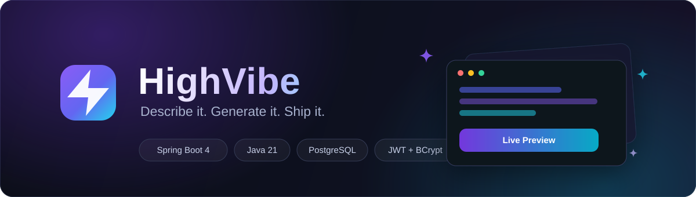
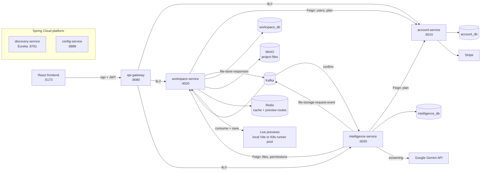
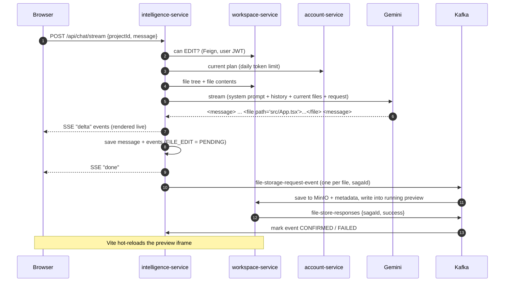

<div align="center">



**A site that creates another site.**

HighVibe is an AI app builder in the spirit of Lovable: describe the app you want, and HighVibe
writes a real React project, runs it in a live preview, and keeps iterating with you in chat.
It is built as a set of Spring Boot microservices with an event-driven file pipeline, plus a
React frontend.

<br/>

[](https://openjdk.org/projects/jdk/21/)
[](https://spring.io/projects/spring-boot)
[](https://spring.io/projects/spring-cloud)
[](https://kafka.apache.org/)
[](https://react.dev/)

[](https://www.postgresql.org/)
[](https://redis.io/)
[](https://min.io/)
[](https://stripe.com/)
[](LICENSE)

</div>

---

## Table of Contents

- [What it does](#what-it-does)
- [Architecture](#architecture)
- [Services](#services)
- [How a prompt becomes an app](#how-a-prompt-becomes-an-app)
- [Tech stack](#tech-stack)
- [Run it locally](#run-it-locally)
- [Configuration](#configuration)
- [API reference](#api-reference)
- [Security model](#security-model)
- [Testing](#testing)
- [Deploying](#deploying)
- [API guide and Postman collection](#api-guide-and-postman-collection)
- [Project structure](#project-structure)
- [License](#license)

---

## What it does

1. **Describe** — type an idea on the home page ("a habit tracker with streaks").
2. **Generate** — the AI writes a React + TypeScript + Vite + Tailwind CSS + daisyUI project,
   streaming its plan and every file into the chat as it works.
3. **Preview** — each project gets a live Vite dev server; edits hot-reload in the preview.
4. **Iterate** — keep chatting ("make the header sticky", "add dark mode"), or edit code directly
   in the built-in code view.
5. **Collaborate** — invite teammates as editors or viewers; invitations must be accepted.
6. **Ship & bill** — download the code as a zip; Free / Pro / Business plans with Stripe checkout
   gate projects, daily AI tokens and concurrent previews.

---

## Architecture



Design choices:

- **Database per service** — each service owns its schema; cross-service data travels over
  Feign (synchronous reads) or Kafka (state changes).
- **Edge + service authentication** — the gateway rejects unauthenticated traffic early, and every
  service re-validates the same JWT, so a service is never exposed by a gateway misroute.
- **Token relay** — Feign calls carry the caller's JWT, so permission checks always run as the
  real user (`/internal/**` APIs are not routed by the gateway).
- **Saga for generated files** — the AI turn is persisted first; each file save is an idempotent
  Kafka request whose outcome flips the chat event from `PENDING` to `CONFIRMED` or `FAILED`.
- **Centralised config** — `config-service` serves `config/*.yaml` (native profile, no git
  credentials needed); every value can be overridden by an environment variable.

---

## Services

| Service | Port | Responsibilities |
| --- | --- | --- |
| `discovery-service` | 8761 | Eureka service registry |
| `config-service` | 8888 | Spring Cloud Config server for all services |
| `api-gateway` | 8080 | Routing, JWT validation, CORS (Spring Cloud Gateway, WebFlux) |
| `account-service` | 9010 | Signup/login, rotating refresh tokens, plans, subscriptions, Stripe checkout/portal/webhooks |
| `workspace-service` | 9020 | Projects, members & invitations, file tree on MinIO, starter template, live previews, zip export |
| `intelligence-service` | 9030 | AI chat (SSE streaming) with Google Gemini, chat history, daily token metering, saga coordinator |
| `common-lib` | — | Shared DTOs, events, enums, error contract, JWT filter and security auto-configuration |
| `frontend` | 5173 | React 18 + TypeScript + Tailwind CSS 4 single-page app |

---

## How a prompt becomes an app



**AI provider.** Code is generated by **Google Gemini** (`GEMINI_API_KEY`, free tier from
[Google AI Studio](https://aistudio.google.com/apikey)) through its streaming REST API
(`streamGenerateContent`); the current project files are sent with every request. Without a key, an
offline **demo generator** builds a sample landing page from the prompt, so the whole pipeline (chat,
saga, preview) still works, but it cannot build custom apps. Both implement one `CodeGenerator`
interface, chosen with `AI_PROVIDER`.

**Previews.** `PREVIEW_MODE=local` (default) materialises the project under `runtime/previews/<id>`,
runs `npm install` + `vite` on a free port (5200–5299) and syncs every saved file to disk.
`PREVIEW_MODE=kubernetes` claims a pod from a warm runner pool, mirrors the project from MinIO,
and registers a `project-<id>.<domain>` route in Redis for the wildcard preview proxy (`k8s/previews`).
Previews expire after `PREVIEW_TTL` (60 minutes by default) and count against the plan.

---

## Tech stack

| Layer | Technology |
| --- | --- |
| Language / runtime | Java 21 (virtual threads), Node.js 22 |
| Backend | Spring Boot 4.0, Spring Cloud 2025.1 (Gateway, Config, Eureka, OpenFeign), Spring Security, Spring Data JPA, Spring Kafka |
| Data | PostgreSQL 16, Redis 7, MinIO (S3 API), Apache Kafka 3.9 (KRaft) |
| AI | Google Gemini API (REST streaming), offline demo generator |
| Billing | Stripe Checkout, Customer Portal, signed webhooks |
| Previews | Vite dev servers (local) or Kubernetes runner pool via fabric8 |
| Frontend | React 18, TypeScript, Vite 6, Tailwind CSS 4, lucide-react |
| Generated apps | React 18 + TypeScript + Vite + Tailwind CSS 4 + daisyUI 5 |

---

## Run it locally

### Prerequisites

| Requirement | Notes |
| --- | --- |
| Docker Desktop | runs PostgreSQL, Kafka, Redis and MinIO |
| JDK 21 | any distribution (or a portable JDK in `.tools/jdk-21`, which the scripts pick up) |
| Node.js 20+ | frontend and local previews |

### 1. Start the infrastructure

```bash
docker compose up -d
```

This starts PostgreSQL (with `account_db`, `workspace_db`, `intelligence_db`), Kafka, Redis and
MinIO (S3 API on port 9000, user `highvibe` / `highvibe-secret`).

### 2. (Optional) add your keys

```bash
cp .env.example .env    # then set GEMINI_API_KEY, Stripe keys, ...
```

### 3. Start the services and the frontend

Windows PowerShell:

```powershell
.\scripts\start-services.ps1
```

The script builds the services if needed, starts them in dependency order (Eureka → config →
services → gateway), then starts the frontend. Logs are written to `runtime/logs/`.
Stop everything with `.\scripts\stop-services.ps1`.

Manual start (any OS), each in its own terminal:

```bash
cd backend && ./mvnw install -DskipTests && cd ..
java -jar backend/discovery-service/target/discovery-service-1.0.0.jar
java -jar backend/config-service/target/config-service-1.0.0.jar
java -jar backend/account-service/target/account-service-1.0.0.jar
java -jar backend/workspace-service/target/workspace-service-1.0.0.jar
java -jar backend/intelligence-service/target/intelligence-service-1.0.0.jar
java -jar backend/api-gateway/target/api-gateway-1.0.0.jar
cd frontend && npm install && npm run dev
```

Open **http://localhost:5173**, sign up, and describe your first app.

### Everything in containers

```bash
docker compose --profile apps up -d --build
```

---

## Configuration

All settings live in `backend/config-service/src/main/resources/config/` and read environment variables:

| Variable | Default | Purpose |
| --- | --- | --- |
| `JWT_SECRET_KEY` | dev value | Shared HMAC signing key (32+ chars; HS384 at 48+ bytes, HS512 at 64+) — **change outside local dev** |
| `JWT_ACCESS_TTL` / `JWT_REFRESH_TTL` | `30m` / `30d` | Token lifetimes |
| `AI_PROVIDER` | `auto` | `gemini`, `demo`, or `auto` (Gemini when a key is set, else demo) |
| `GEMINI_API_KEY` / `GEMINI_MODEL` | — / `gemini-3.5-flash-lite` | Google Gemini, free tier ([get a key](https://aistudio.google.com/apikey)) |
| `STRIPE_SECRET_KEY` / `STRIPE_WEBHOOK_SECRET` | — | Stripe billing; without them plan changes apply instantly (`BILLING_MOCK_MODE=true`) |
| `STRIPE_PRICE_PRO` / `STRIPE_PRICE_BUSINESS` | — | Stripe price ids attached to the plans at startup |
| `DB_USERNAME` / `DB_PASSWORD` | `highvibe` | PostgreSQL credentials |
| `*_DB_URL` | `localhost:5432/<service>_db` | Per-service JDBC URLs |
| `KAFKA_BOOTSTRAP_SERVERS` | `localhost:9092` | Kafka |
| `REDIS_HOST` | `localhost` | Redis |
| `MINIO_URL` / `MINIO_ACCESS_KEY` / `MINIO_SECRET_KEY` | local MinIO | Object storage |
| `PREVIEW_MODE` | `local` | `local` or `kubernetes` |
| `PREVIEW_TTL` | `60m` | Idle lifetime of a preview |
| `FRONTEND_URL` | `http://localhost:5173` | Used for Stripe redirect URLs |
| `CORS_ALLOWED_ORIGINS` | localhost:5173 | Gateway CORS allow-list |

---

## API reference

All routes go through the gateway (`http://localhost:8080`). Everything except signup, login,
refresh, the plan catalog and the Stripe webhook requires `Authorization: Bearer <token>`.
Errors share one shape: `{"status": "...", "message": "...", "timestamp": "...", "errors": [...]}`.

**Auth** (`account-service`)

| Method | Path | Description |
| --- | --- | --- |
| POST | `/api/auth/signup` | Create account → `{token, refreshToken, expiresIn, user}` |
| POST | `/api/auth/login` | Log in → same shape |
| POST | `/api/auth/refresh` | Rotate the refresh token, get a new access token |
| POST | `/api/auth/logout` | Revoke a refresh token |
| GET | `/api/auth/me` | Current user |

**Billing** (`account-service`)

| Method | Path | Description |
| --- | --- | --- |
| GET | `/api/billing/plans` | Plan catalog (public) |
| GET | `/api/billing/subscription` | Current plan and status |
| POST | `/api/billing/checkout` | `{planId}` → Stripe Checkout URL (or instant switch in mock mode) |
| POST | `/api/billing/portal` | Stripe Customer Portal URL |
| POST | `/api/billing/webhook` | Stripe webhook (signature-verified, idempotent) |

**Projects, files, previews, team** (`workspace-service`)

| Method | Path | Permission |
| --- | --- | --- |
| GET / POST | `/api/projects` | list mine / create (plan limit, seeded from the starter template) |
| GET / PATCH / DELETE | `/api/projects/{id}` | VIEW / EDIT / DELETE (soft delete) |
| GET | `/api/projects/{id}/files` | VIEW — file tree (Redis-cached) |
| GET / PUT / DELETE | `/api/projects/{id}/files/content?path=` | VIEW / EDIT / EDIT |
| GET | `/api/projects/{id}/download` | VIEW — zip of the project |
| POST | `/api/projects/{id}/deploy` | VIEW — start (or reuse) the live preview |
| GET / DELETE | `/api/projects/{id}/preview` | VIEW — preview status / stop |
| GET / POST | `/api/projects/{id}/members` | VIEW / MANAGE_MEMBERS (invite) |
| PATCH / DELETE | `/api/projects/{id}/members/{userId}` | MANAGE_MEMBERS (anyone may remove themselves) |
| GET | `/api/invitations` | my pending invitations |
| POST / DELETE | `/api/invitations/{projectId}[/accept]` | accept / decline |

**AI** (`intelligence-service`)

| Method | Path | Description |
| --- | --- | --- |
| POST | `/api/chat/stream` | `{projectId, message}` → `text/event-stream` of `delta` / `done` / `error` |
| GET | `/api/chat/projects/{id}` | Chat history with parsed events |
| GET | `/api/usage/today` | Tokens used today vs. plan limit |

```bash
TOKEN=$(curl -s -X POST localhost:8080/api/auth/signup -H 'Content-Type: application/json' \
  -d '{"username":"ada@example.com","name":"Ada","password":"secret123"}' | jq -r .token)

curl -s -X POST localhost:8080/api/projects -H "Authorization: Bearer $TOKEN" \
  -H 'Content-Type: application/json' -d '{"name":"Habit tracker"}'

curl -N -X POST localhost:8080/api/chat/stream -H "Authorization: Bearer $TOKEN" \
  -H 'Content-Type: application/json' -d '{"projectId":1,"message":"Build a habit tracker"}'
```

---

## Security model

| Permission | OWNER | EDITOR | VIEWER |
| --- | :---: | :---: | :---: |
| `VIEW` project, files, preview, chat history | ✓ | ✓ | ✓ |
| `EDIT` project, files, AI generation | ✓ | ✓ | — |
| `DELETE` project | ✓ | — | — |
| `MANAGE_MEMBERS` invite, re-role, remove | ✓ | — | — |

- Stateless HMAC-signed JWT (HS384 with the local key) with short-lived access tokens and **rotating, hashed refresh tokens**;
  replaying a revoked refresh token revokes all of that user's sessions.
- Malformed, expired or forged tokens leave the request anonymous → clean JSON `401`.
- Non-members get `404` for a project (existence is not revealed); members without the
  permission get `403`. Pending invitees have no access until they accept.
- One owner per project: `OWNER` cannot be invited, assigned or removed.
- File paths are normalised and validated (no `..`, absolute paths, backslashes or `node_modules`).
- Stripe webhooks are signature-verified and processed once per event id.
- Passwords are BCrypt-hashed; no secrets are committed (`.env` is git-ignored).

---

## Testing

```bash
cd backend && ./mvnw verify      # backend unit + web-layer tests
cd frontend && npm run build   # type-check + production build
```

The suite covers the JWT filter (valid / expired / forged / malformed tokens), account-service
HTTP security wiring and validation, the LLM response parser, the offline generator, and path
validation. CI runs both on every push (`.github/workflows/ci.yml`).

---

## Deploying

- **Free server (recommended):** [`docs/DEPLOYMENT.md`](docs/DEPLOYMENT.md) walks through an Oracle Cloud
  Always Free VM (4 CPUs, 24 GB RAM). On the server, one command installs Docker, writes the secrets and
  starts the whole stack:
  `curl -fsSL https://raw.githubusercontent.com/Asmit057/HighVibe/main/scripts/deploy.sh | bash`
- **Containers:** `backend/Dockerfile` builds any service (`--build-arg MODULE=<service>`);
  `frontend/Dockerfile` serves the SPA with nginx and proxies `/api` to the gateway.
  `docker compose --profile apps up` runs the full stack on one host; adding `-f docker-compose.prod.yml`
  keeps everything except the website and the preview ports private.
- **Kubernetes previews:** apply `k8s/previews/runner-pool.yaml`, build and deploy the proxy in
  `k8s/previews/proxy`, point a wildcard DNS record at it, and run workspace-service with
  `PREVIEW_MODE=kubernetes` and `PREVIEW_DOMAIN=<your preview domain>`.
- **Production checklist:** set `JWT_SECRET_KEY`, database/MinIO credentials, `FRONTEND_URL`,
  `CORS_ALLOWED_ORIGINS`, Stripe keys with `BILLING_MOCK_MODE=false`, and `GEMINI_API_KEY`.

---

## API guide and Postman collection

- [`docs/HighVibe-Start-Here.pdf`](docs/HighVibe-Start-Here.pdf) — which guide to read in which order, a 14-day study plan,
  nine debugging labs that stop the code on real requests (breakpoints by file and line, plus commands to look inside PostgreSQL,
  Redis, Kafka and MinIO), and interview answers that point at the code.
- [`docs/HighVibe-Learn-the-Backend.pdf`](docs/HighVibe-Learn-the-Backend.pdf) — the first guide to read if you are new: a 15-step path from
  "what is a backend" to the Kafka saga, each step with something to try on your laptop, the files to open and questions to check yourself.
- [`docs/HighVibe-Defect-Report.pdf`](docs/HighVibe-Defect-Report.pdf) — 14 open defects found by testing and code review,
  each with steps to reproduce, the cause, hints to fix and how to verify, ordered from beginner to advanced.
- [`docs/HighVibe-API-Reference.pdf`](docs/HighVibe-API-Reference.pdf) — all 43 APIs in Swagger style, one card each: what it
  does, who can call it, how it works inside, and a real recorded request and response (plus real error examples).
- [`docs/HighVibe-Interview-Guide.pdf`](docs/HighVibe-Interview-Guide.pdf) — microservices, Kafka, Redis, MinIO, PostgreSQL and
  Docker explained from zero, how each is used in HighVibe, and 40 interview questions with answers.
- [`docs/HighVibe-User-Guide.pdf`](docs/HighVibe-User-Guide.pdf) — for anyone who downloads the ZIP: every feature,
  installing the tools, running HighVibe with Docker or in developer mode, and every screen and button explained.
- [`docs/HighVibe-Project-Explained.pdf`](docs/HighVibe-Project-Explained.pdf) — what the project is,
  a user's journey with what happens behind the scenes, every end-to-end flow step by step, what each backend
  API is for and who calls it, and what data is stored where.
- [`docs/HighVibe-Backend-API-Guide.pdf`](docs/HighVibe-Backend-API-Guide.pdf) — every endpoint with request and
  response examples, how the frontend and backend are connected, the backend concepts (gateway, Eureka,
  config server, JWT + refresh rotation, RBAC, Feign token relay, Kafka saga, SSE, MinIO, Redis, Stripe),
  a 10-minute demo script and common interview questions.
- [`docs/HighVibe-Frontend-Guide.pdf`](docs/HighVibe-Frontend-Guide.pdf) — how the React app is organised, how it
  connects to the backend (the `/api` proxy, tokens and silent refresh, SSE streaming, the preview iframe), how the
  frontend and Docker builds work, and the exact commands that start everything.
- [`docs/DEPLOYMENT.md`](docs/DEPLOYMENT.md) — putting HighVibe on a free Oracle Cloud server with one script.
- [`docs/HighVibe.postman_collection.json`](docs/HighVibe.postman_collection.json) — import into Postman, run
  **Auth › Sign up**, then any request: tokens and ids are captured automatically.

---

## Project structure

```
HighVibe
├── backend/                   Spring Boot microservices (Maven multi-module, ./mvnw)
│   ├── common-lib/            shared DTOs, events, errors, JWT security auto-config
│   ├── discovery-service/     Eureka
│   ├── config-service/        config server + config/*.yaml for every service
│   ├── api-gateway/           Spring Cloud Gateway, JWT filter, CORS
│   ├── account-service/       auth, refresh tokens, plans, subscriptions, Stripe
│   ├── workspace-service/     projects, members, MinIO files, template, previews, Kafka consumer
│   │   └── src/main/resources/templates/react-vite-starter/   starter for every new project
│   ├── intelligence-service/  chat, Gemini/demo generators, SSE, usage, saga handler
│   └── Dockerfile             builds any service image
├── frontend/                  React app (home, workspace, billing) + nginx Dockerfile
├── docs/                      project explanation + API guide (PDF), Postman collection, deployment guide
├── infra/postgres/            PostgreSQL init script (one database per service)
├── k8s/previews/              runner pool + wildcard preview proxy
├── scripts/                   start/stop scripts for local development, deploy.sh for a server
├── docker-compose.yml         infrastructure (+ "apps" profile for the full stack)
└── docker-compose.prod.yml    server overrides: private network, restarts, memory limits
```

---

## License

Released under the [MIT License](LICENSE).

## Author

**Asmit** — [@Asmit057](https://github.com/Asmit057)
